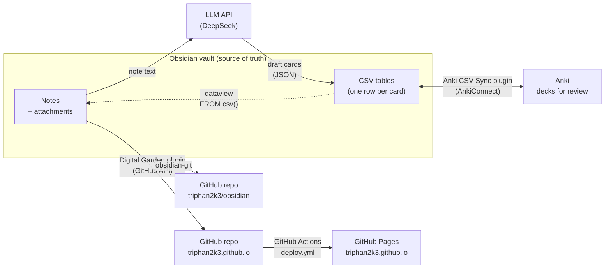

---
{"dg-publish":true,"permalink":"/00-resource/1-guide/obsidian-digital-garden/","tags":["guide","digital-garden","gardenEntry"],"dg-note-properties":{"tags":["guide","digital-garden","gardenEntry"]}}
---


# Obsidian Digital Garden

How notes from this vault become the site at https://triphan2k3.github.io.

## Architecture



Everything is written once, in Obsidian. Anki can send cards back (pull), and the LLM (planned) would only draft cards into a CSV for review; the site only receives copies.

### Obsidian

- The vault is the only place content is edited. Anki cards and web pages are generated from it.
- Backed up with the **obsidian-git** plugin to the repo `triphan2k3/obsidian`.
- Table-like data lives in CSV files next to the notes (e.g. `21. Application/Cube/db.csv`, one row per case). Notes show them with a normal `dataview` query, `FROM csv("path/to/file.csv")`, e.g. the tables in [[21. Application/Cube/Cube\|Cube]]. Avoid `dataviewjs` for published tables: it is published as Obsidian-rendered HTML, so images point to `app://` paths and break on the site.

### Anki

- The local plugin **Anki CSV Sync** (`.obsidian/plugins/anki-csv-sync`) talks to Anki through the **AnkiConnect** add-on. Anki must be running.
- Each CSV row is one Anki note: `anki_nid`, `deck`, `model`, `tags`, plus one column per card field (`Front`, `Back`, ...). Other columns are ignored by Anki.
- Commands:
	- **Pull Anki deck into CSV**: adds/updates rows by `anki_nid` (Anki wins for those fields); your own rows and columns are kept.
	- **Push CSV to Anki**: updates notes that exist (review history kept), creates the rest and writes their `anki_nid` back. Rows with an empty `deck` are skipped.
	- **Push CSV to Anki (dry run)**: shows what would change.
- Field text is plain text; line breaks become `<br>`, and `![[image.svg|150]]` uploads the image and becomes ``.
- Current decks: `Cube::*` from `21. Application/Cube/db.csv` (57 rows with a deck; OLL/PLL rows have none yet) and `L_vim` from `21. Application/Vim/vim.csv`.
- Don't rename or clear `anki_nid`, or the next push creates a duplicate card.
- Review happens in Anki. Learning progress (`status`) is updated manually.

### LLM (planned)

- Not built yet. Idea: send a note (or a selection) to an LLM such as DeepSeek and get Anki cards back as JSON.
- The cards land in a CSV table as drafts (empty `anki_nid`), get reviewed and edited there, and only reach Anki through **Push CSV to Anki**.
- Note text sent to the LLM leaves the machine, so it shouldn't be used on private notes.

### GitHub Pages

- The **Digital Garden** plugin commits notes marked `dg-publish: true` to the repo `triphan2k3/triphan2k3.github.io`.
- Each push to `master` runs `deploy.yml` (Eleventy build), which deploys to GitHub Pages.
- Publishing is one-way: the site never writes back to the vault.

## How it works

1. The **Digital Garden** plugin compiles marked notes and commits them to the GitHub repo `triphan2k3/triphan2k3.github.io` (branch `master`).
2. Notes land in `src/site/notes/`, images in `src/site/img/user/`.
3. Every push to `master` runs the GitHub Actions workflow `deploy.yml`, which builds the site with Eleventy and deploys it to GitHub Pages. The site is live about a minute later.

> [!important]
> Publish content **from Obsidian only**. Don't edit `src/site/notes/` in the repo by hand; the plugin owns it.

## Publishing a note

1. Add `dg-publish: true` to the note's properties (or run **Digital Garden: Add publish flag**).
2. Run **Digital Garden: Open Publication Center**.
3. Check the lists of new, changed and deleted notes, then click **Publish**.

To take a note down, set `dg-publish: false` (or remove it) and publish again. The note shows up under deleted notes.

## Note properties

| Property | Effect |
| --- | --- |
| `dg-publish: true` | Publish the note |
| `dg-home: true` | Make it the home page (only one note). Currently this note |
| `dg-hide-in-filetree: true` | Keep the page, but hide it from the sidebar |
| `dg-hide: true` | Hide from the sidebar and the graph |
| `dg-hide-in-graph: true` | Hide from the graph only |
| `dg-pinned: true` | Pin to the top of its folder in the sidebar |
| `dg-permalink: my-url` | Custom URL instead of the folder path |
| `dg-path: Folder/Name` | Show the note at a different path in the site |
| `title: ...` | Title shown on the page and in the sidebar |

URLs come from the vault path, lowercased with dashes: `21. Application/Cube/PLL/PLL T.md` becomes `/21-application/cube/pll/pll-t/`. Moving or renaming a note changes its URL.

## What gets converted

- **Links** `[[Note]]` become links to the published note. Links to unpublished notes are shown as dead links.
- **Images** `![[image.png]]` are uploaded with the note. `![[image.png|150]]` sets the width.
- **Dataview**: ` ```dataview ` blocks are turned into static tables at publish time, using the vault's current data. Re-publish to refresh them.
	- ` ```dataview_ ` (with the underscore) is not a query, so it is published as a raw code block. That's why OLL and PLL in [[21. Application/Cube/Cube\|Cube]] show the query text.
- **Math** `$...$` and `$$...$$` work.

## Canvas

A canvas has no properties panel, so the flag goes inside the `.canvas` file (edit it as text, e.g. in VS Code):

```json
"metadata": {
	"frontmatter": {
		"dg-publish": true
	}
}
```

Put it next to `"nodes"` and `"edges"`, then publish from the Publication Center. The page is zoomable and its URL ends in `.canvas/`.

## Look and settings

- Site name, theme (currently AnuPpuccin) and light/dark mode are set in the plugin settings under **Appearance**. Saving them commits an "Update settings" change to the repo.
- Extra CSS goes in `src/site/styles/custom-style.scss` in the repo (code change, via a PR).
- The sidebar always shows a folder, even when every note in it is hidden. Hiding the empty folders themselves would need a CSS change in the repo.

## Repo notes

- `static/` holds files copied into the site as-is:
	- `sw.js` clears the old Jekyll blog's offline cache for returning visitors.
	- `2022/05/04/...`, `2025/01/01/...`, `2026/02/14/...` redirect old blog post URLs to the new pages.
- `scripts/publish-local.js` imitates the plugin for local previews (not for publishing).
- Local preview:
	```sh
	npm run publish:local -- ../../obsidian "21. Application/Cube" "05. Write"
	NODE_USE_SYSTEM_CA=1 npm run site:build
	npm run serve:dist   # http://localhost:8080
	```
	`NODE_USE_SYSTEM_CA=1` is needed on the work laptop, because the company network replaces GitHub's TLS certificate.

## Links

- Docs: https://docs.forestry.md
- Template: https://github.com/oleeskild/digitalgarden
